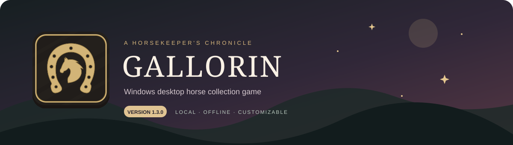

<div align="center">



# Gallorin v1.1.1: The Melodies of Gallorin

**Desktop horse collection game · Windows**

[Download](https://github.com/zanderlx/Gallorin/releases/latest) · [Changelog](CHANGELOG.md)

</div>

## Features

- Explore zones and tame, rename, favorite, sell, import, and export horses.
- Inspect horse details, palettes, traits, mutations, notes, and skill XP.
- Customize species, traits, palettes, eye colors, personalities, rarities, and zones through the Compendium.
- Manage location playlists and sound effects with smooth crossfades, a compact player, and confirmation before removing playlist songs.
- Adjust themes, page text, profiles, economy, and spawning settings.
- Save locally with exports and automatic backups.

Breeding, Town activities, equipment gameplay, and skill training remain planned. Developer Horse Updates is a work in progress.

## Play — recommended

1. Download the **Gallorin Setup .exe** from [Releases](https://github.com/zanderlx/Gallorin/releases/latest).
2. Run the installer, then open Gallorin from its shortcut.
3. Select **Play**.

The installer includes everything needed. Players do not need Node.js, Git, npm, or the source folder.

**Future updates:** the installed app checks for published releases. Use **Gallorin → Check for Updates**, choose **Download**, then **Restart and Install**. You can update inside the app without downloading another installer manually. Saves and personal settings are retained.

## Local development

Install [Node.js 22+ with npm](https://nodejs.org/en/download), then open a terminal in the repo root.

For a fresh clone without dependencies, install them once:

```sh
npm ci
```

Start the desktop app using your current source:

```sh
npm run desktop
```

If dependencies are already installed, use just `npm run desktop`. Repeat `npm ci` when dependency files change.

Refresh the app with **Ctrl+R** after UI changes. Restart `npm run desktop` after Electron or backend changes. This launches a development app with separate saves; it does not rebuild or update your installed copy.

## Browser play — optional

After the same dependency setup, run:

```sh
npm start
```

Open **http://127.0.0.1:4173**. Keep the terminal open while playing.

On Windows, **Launch Gallorin.vbs** starts the browser edition after setup; **Stop Gallorin.vbs** stops it.

## Saves & backups

| Edition | Data folder |
| --- | --- |
| Installed desktop | `%APPDATA%\Gallorin\data` |
| Desktop development | `%APPDATA%\Gallorin Development\data` |
| Browser | `data` inside the repo |

Horses, configuration, imported audio, and playlists stay local. Updates replace app files while retaining saved data. Use **Developer Settings → Save Management** for exports and backups; copy the music folder separately when transferring imported audio.

## Versions & guides

Versions use **major.minor.patch**. New features can increase the minor version; subsequent small fix releases increase the patch number.

[Changelog and Aetherion legacy history](CHANGELOG.md) · [Desktop guide](desktop/README.md) · [Music guide](docs/music.md)
